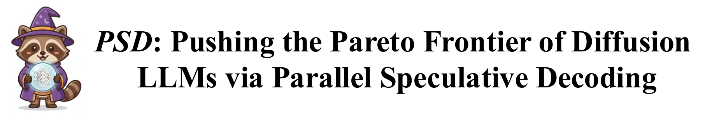
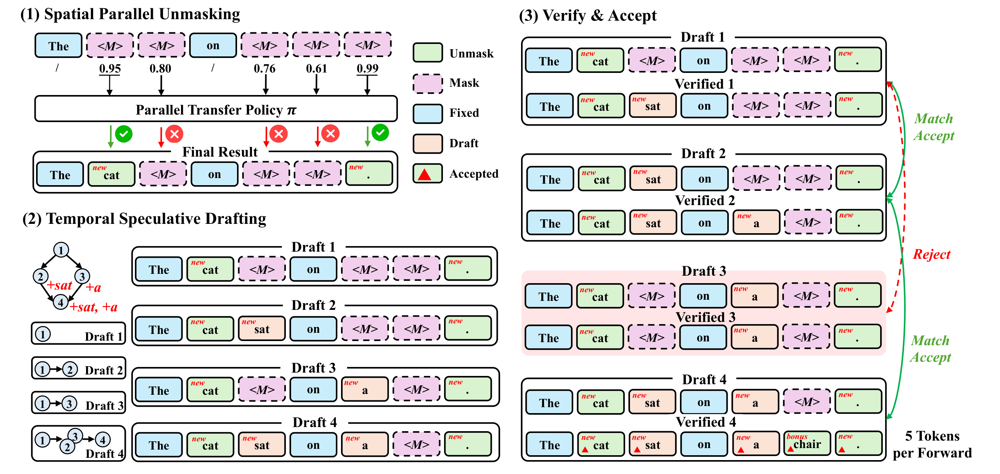

<div align="center">



<a href="https://arxiv.org/abs/2605.15609"></a>
<a href="https://pytorch.org/"></a>

</div>

<br/>


This is the Pytorch implementation for our paper: [**PSD: Pushing the Pareto Frontier of Diffusion LLMs via Parallel Speculative Decoding**](https://arxiv.org/abs/2605.15609). 

## Abstract
<div style="text-align: justify;">
  Diffusion large language models (dLLMs) generate text by iteratively denoising masked token sequences. Although dLLMs can predict all masked positions in parallel within each step, the large number of denoising iterations still makes inference expensive. This cost can be reduced spatially by unmasking multiple tokens per step, or temporally by collapsing multiple denoising steps into one verification call. We propose Parallel Speculative Decoding (PSD), a training-free framework that jointly improves inference along both axes. Using the confidence scores from a single forward pass, PSD selects positions to unmask via a configurable, adaptive unmasking policy and constructs multi-depth speculative drafts without extra model calls. A final batched verification pass then applies hierarchical acceptance, keeping the deepest draft that remains consistent with the updated predictions. Experiments on three dLLMs across reasoning and code generation tasks show that PSD achieves favorable trade-offs between inference efficiency and generation quality, reaching up to $5.5\times$ tokens per forward pass with accuracy comparable to greedy decoding.
</div>
<br>



## Requirements

The PSD generation and evaluation pipeline uses one Python 3.10–3.12 environment with the following key packages:

```text
torch>=2.7,<2.8
transformers==4.53.3
accelerate>=1.10
datasets>=3.6,<4
huggingface_hub>=0.30,<1
```

For the complete installable dependency list, see [requirements.txt](requirements.txt). The launcher reuses a compatible environment when available; otherwise, it creates a project-local `.venv/` and installs the dependencies. A fresh environment uses PyTorch 2.7.1 with CUDA 12.8 wheels by default.

Run the experiments on Linux with an NVIDIA GPU, a compatible NVIDIA driver, and enough GPU memory for the selected model and draft batch. Larger `k` values require more GPU memory. Internet access is needed to install missing dependencies and download missing assets. HumanEval and MBPP evaluation also requires Linux Landlock ABI >= 3 and `libseccomp.so.2` for the restricted code-execution subprocess.

## Code Structure

```text
PSD/
├── configs/
│   └── assets.json                       # Model repositories and dataset revisions
├── datasets/                             # Dataset directory placeholders
│   ├── gsm8k/
│   ├── humaneval/
│   └── mbpp/
├── evaluation/
│   ├── assets.py                         # Check and prepare models and datasets
│   ├── experiment.py                     # Experiment matrix and idle-GPU scheduling
│   ├── experiment_worker.py              # Generation and scoring for each model/dataset
│   ├── experiment_report.py              # Aggregate ACC, TPS, TPF, and conversion
│   ├── experiment_utils.py               # Plans, source hashes, and GPU checks
│   ├── benchmark.py                      # Prompts, model adapters, and generation timing
│   ├── scoring.py                        # Answer extraction and accuracy scoring
│   ├── code_execution.py                 # Code-test subprocess launcher
│   └── sandbox_child.py                  # Restricted execution of generated programs
├── models/                               # Checkpoint placeholders; weights are not tracked
│   ├── Dream-v0-Base-7B/
│   ├── LLaDA-1.5/
│   └── openPangu-7B-Diffusion-Base/
├── src/
│   ├── psd.py                            # Shared multi-parent DAG drafting and acceptance
│   ├── stopping.py                       # EOS handling and emitted-token accounting
│   ├── dream/                            # Dream model and decoding implementations
│   ├── llada/                            # LLaDA model and decoding implementations
│   └── openpangu/                        # openPangu model and decoding implementations
├── scripts/
│   └── bootstrap.py                      # Runtime discovery and environment preparation
├── fig/                                  # README figures
├── exp.sh                                # 🚀 Run here: Run the complete experiment matrix
├── requirements.txt                      # Installable Python dependencies
└── README.md
```

## Model Weights

The default experiments evaluate three diffusion language models. `bash exp.sh` checks each checkpoint and downloads missing model files to the matching directory below. Complete local checkpoints are reused. To prepare weights manually, place the model configuration, tokenizer files, weight index, and all weight shards in that same directory.

| Model | Local directory | Download |
| :--- | :--- | :--- |
| Dream-v0-Base-7B | `models/Dream-v0-Base-7B/` | [Hugging Face](https://huggingface.co/Dream-org/Dream-v0-Base-7B) |
| LLaDA-1.5 | `models/LLaDA-1.5/` | [Hugging Face](https://huggingface.co/GSAI-ML/LLaDA-1.5) |
| openPangu-7B-Diffusion-Base | `models/openPangu-7B-Diffusion-Base/` | [Hugging Face](https://huggingface.co/openpangu/openPangu-7B-Diffusion-Base) |

Model repository IDs and dataset revisions are defined in [configs/assets.json](configs/assets.json). Fresh model downloads record their resolved repository commit for provenance.

## Datasets

Missing datasets are downloaded and converted to local JSONL files automatically. Existing local files are checked for the expected schema and split size.

| Dataset | Evaluation protocol | Full evaluation size | Local files |
| :--- | :--- | ---: | :--- |
| GSM8K | 5-shot mathematical reasoning | 1,319 | `datasets/gsm8k/train.jsonl`, `datasets/gsm8k/test.jsonl` |
| HumanEval | 0-shot code generation | 164 | `datasets/humaneval/test.jsonl` |
| MBPP | 3-shot code generation | 500 | `datasets/mbpp/prompt.jsonl`, `datasets/mbpp/test.jsonl` |

The default run uses the first 50 evaluation samples from each dataset, shared across all decoding configurations. Use `--samples all` to evaluate the full splits.

## Run

From the repository root, run:

```bash
bash exp.sh
```

This command prepares the runtime and missing assets, waits for idle GPUs, runs generation and accuracy evaluation, and writes the final summary tables. It covers all three models and datasets with the following decoding configurations:

| Method | Speculative depth `k` |
| :--- | :--- |
| Greedy | Measured once per model and dataset |
| PSD confidence | 1, 3, 5, 7 |
| PSD local leap | 1, 3, 5, 7 |

## Acknowledgment of Open-Source Code Contributions

  This code is based on the open-source repository [Fast-dLLM](https://github.com/NVlabs/Fast-dLLM). Many thanks to the authors!

You are welcome to cite our paper:
```
@inproceedings{SunLi26,
  title={{PSD}: Pushing the Pareto Frontier of Diffusion LLMs via Parallel Speculative Decoding},
  author={Shengyin Sun, Yiming Li, Renxi Liu, Xinqi Li, Hui-Ling Zhen, Weizhe Lin, Chen Chen, Xianzhi Yu, Mingxuan Yuan, Chen Ma},
  booktitle={arXiv:2605.15609},
  year={2026}
}
```
